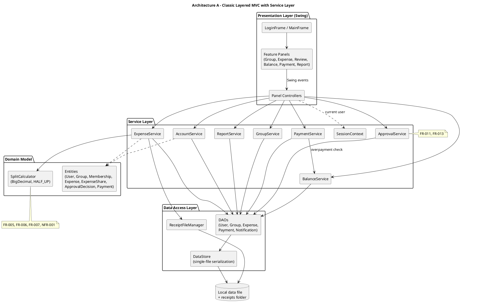
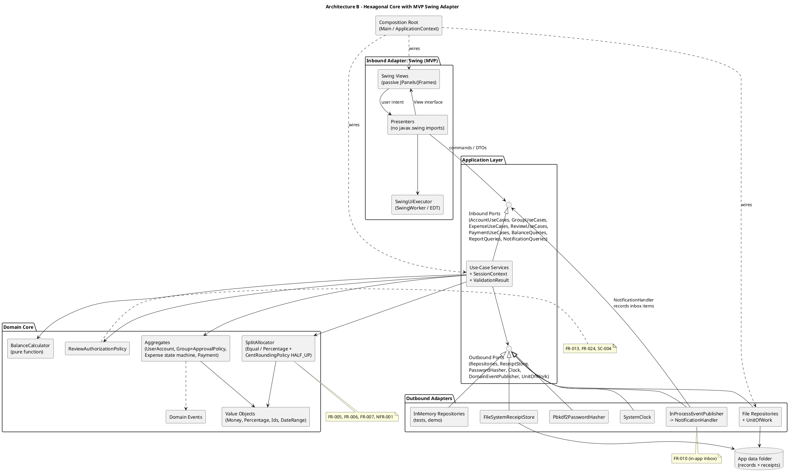
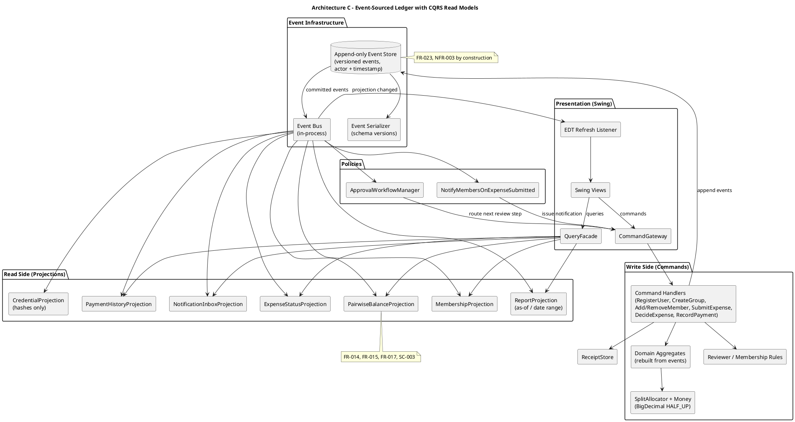

# SplitSmart: Architecture Alternatives for the Java Swing MVP

> **HISTORICAL DOCUMENT (superseded 2026-11-03).** This analysis predates customer decisions D01–D41. The selected architecture is **Layered + MVC for a Spring Boot web application** ([ADR-001](ADR-001-Architecture-Selection.md), Accepted). Swing/desktop and Hexagonal/MVP content below is kept unchanged as historical design alternatives. See [Requirements_Conflict_Resolution](../docs/requirements/Requirements_Conflict_Resolution.md) C-01, C-03.

| Item | Value |
| --- | --- |
| Author | Claude (independent senior-architect review; AI-generated draft, requires human review per Constitution IX / NFR-008) |
| Date | 2026-11-03 |
| Inputs read | `UserRequirement.md`, `specs/001-splitsmart-core/spec.md` (including Clarifications, Session 2026-10-27), `.specify/memory/constitution.md` v1.0.0 |
| Inputs deliberately **not** read | `specs/001-splitsmart-core/plan.md` and the other plan-phase outputs (`research.md`, `data-model.md`, `contracts/`, `architecture.puml`), so this proposal is independent of the Spec Kit plan |
| Scope | Desktop MVP in Java 21 + Maven + Swing + JUnit 5 + BigDecimal + PlantUML. No Java code is included. |

---

## 0. Architectural Drivers

These are the forces every alternative must satisfy. They come from the constitution and the spec.

### 0.1 Hard constraints (constitution)

| ID | Constraint | Source |
| --- | --- | --- |
| C-1 | Java 21, built and tested with Maven | Constitution II |
| C-2 | The UI is Java Swing, and Swing classes contain no business rules | Constitution III, IV; NFR-006 |
| C-3 | The GUI calls application services through explicit interfaces/classes and talks in domain objects or DTOs | Constitution IV |
| C-4 | All money is `BigDecimal` with an explicit scale and rounding mode | Constitution V; NFR-001 |
| C-5 | Non-trivial rules are covered by JUnit 5; GUI tests where GUI behavior is itself a requirement | Constitution VI; NFR-007 |
| C-6 | PlantUML diagrams show the GUI / application / domain boundaries | Constitution VII |
| C-7 | Every design element traces to requirement IDs | Constitution VIII |

### 0.2 Business rules that most shape the architecture (from the clarifications)

| Rule | Requirement IDs | Architectural consequence |
| --- | --- | --- |
| The creator defaults to payer; the payer may be changed to another participant | FR-004 | The expense form must have a payer chooser; payer ∈ participants is a domain invariant |
| Only current active members can be selected; former members stay visible on history | FR-008, FR-027 | Membership needs time/state (active or removed), not deletion; expense shares snapshot participant identity |
| Shares round half-up to cents; the payer absorbs the remainder so the total is exact | NFR-001, FR-005, FR-006 | One pure, deterministic allocation component shared by both split strategies |
| Amount is positive with ≤ 2 decimal places | FR-004, FR-025 | Validation in a `Money` value object, not in the Swing form |
| Percentages must total exactly 100 | FR-007 | Validation before submission, done in the domain or application layer, never only in the UI |
| Only approved expenses affect balances; rejected ones never do | FR-011, FR-013, FR-026 | Expense state machine; balance derivation filters on effective status |
| Approval by the submitter, unauthorized users, or inactive members is denied | FR-013, FR-024 | An authorization policy component the UI cannot bypass |
| History must explain later balances | FR-023, NFR-003 | Decisions and payments are append-only records with actor and timestamp |

### 0.3 Quality attributes ranked for this project

1. **Correctness of money** (NFR-001, SC-003, SC-005)
2. **Testability of business rules without Swing** (NFR-006, NFR-007)
3. **Traceability and auditability** (Constitution VIII, FR-023, NFR-003)
4. **Maintainability and evolvability toward the web target** (FR-022, plus the deferred FR-010, FR-012, FR-021)
5. **Implementation effort that fits a course timeline**

---

## Architecture A: Classic Layered MVC with a Service Layer

### A.1 Component structure and responsibilities

A strict four-layer stack. Each layer may call only the layer directly below it.

| Layer | Components | Responsibilities |
| --- | --- | --- |
| **Presentation (Swing)** | `LoginFrame`, `MainFrame`, panels (`GroupPanel`, `ExpenseFormPanel`, `ReviewPanel`, `BalancePanel`, `PaymentPanel`, `ReportPanel`), one **Controller** per panel | Render data, collect input, react to events. Controllers translate Swing events into service calls and push results back into Swing models (`TableModel`, `ComboBoxModel`). |
| **Service** | `AccountService`, `GroupService`, `ExpenseService`, `ApprovalService`, `BalanceService`, `PaymentService`, `ReportService`, `SessionContext` | Use-case logic: validation, authorization checks, orchestration, and transaction scope around DAO calls. |
| **Domain model** | Entities `User`, `Group`, `Membership`, `Expense`, `ExpenseShare`, `ApprovalDecision`, `Payment`, `Notification`; helpers `SplitCalculator`, `MoneyUtil` | Data structures plus a few calculation helpers. The domain is mostly *anemic*: most rules live in services. |
| **Data access** | Concrete DAOs (`UserDao`, `GroupDao`, `ExpenseDao`, `PaymentDao`, `NotificationDao`), `DataStore` (serializes the whole object graph to one local file), `ReceiptFileManager` | Keep the in-memory collections, load and save the data file, copy receipt images into the app data folder. |

### A.2 Component diagram



### A.3 Major dependencies and interactions

- **Compile-time direction:** Presentation → Service → Domain ← Data Access. Services depend on **concrete** DAO classes (no repository interfaces).
- **Typical flow, submit an expense (FR-004 to FR-009):** `ExpenseFormPanel` → `ExpenseController.onSubmit()` reads the fields → `ExpenseService.submit(form data)` validates the amount, participants, payer, and percentages → `SplitCalculator` allocates shares → `ExpenseDao.save()` → `DataStore.flush()` → the controller refreshes `ReviewPanel` / `BalancePanel`.
- **Approval (FR-011, FR-013):** `ApprovalService.decide(expenseId, decision)` checks that the reviewer is not the submitter and is an active member, records an `ApprovalDecision`, and changes the status to `APPROVED` or `REJECTED`.
- **Balances (FR-014, FR-015):** `BalanceService` recomputes pairwise balances on each request from approved expenses minus payments.
- **External libraries:** none beyond the JDK and JUnit 5 (Java serialization or a hand-written CSV/properties format for persistence; `javax.imageio` for receipt validation; PBKDF2 from `javax.crypto` for password hashing).
- **Threading:** synchronous calls on the Swing Event Dispatch Thread (EDT); file I/O is small enough to tolerate that, or is wrapped in `SwingWorker`.

### A.4 Advantages and disadvantages

| Advantages | Disadvantages |
| --- | --- |
| The best-known structure; most students can implement it without training | The anemic domain lets rules spread across services and controllers; for example, the "payer must be a participant" check gets duplicated |
| Fewest types and files; quickest first demo | Services depend on concrete DAOs, so unit tests need real files or subclassing |
| Clear, easy-to-draw layer diagram (Constitution VII) | Controllers often grow into "god classes" that mix Swing model updates with orchestration |
| No third-party runtime dependencies | Weak extension points for FR-012 (multi-level approval) and FR-010 (notifications): they get bolted onto `ApprovalService` and `ExpenseService` |
| | Java serialization is brittle: changing a class breaks old data files, and it has known security concerns with untrusted files |
| | Reusing it for the web target (FR-022) needs refactoring, because the services are shaped around Swing controller needs |

### A.5 Testability and maintainability

- **Testability: medium.** `SplitCalculator` and `MoneyUtil` are pure and easy to test. Service tests need a real `DataStore` on a temp directory, or DAO subclass fakes. Controllers depend directly on Swing components, so controller logic can only be tested with a GUI harness or through brittle reflection. Meeting NFR-007 ("display-critical workflows") requires a Swing test tool such as AssertJ-Swing.
- **Maintainability: medium to low as features grow.** Fine for the MVP subset. Once notifications, multi-level approval, and custom reports arrive, the services grow large and change for many unrelated reasons.

### A.6 Complexity and implementation effort

- **Complexity:** low. About 35–45 production classes.
- **Effort (relative):** **1.0×** baseline. Roughly 3 iterations for a 3–4 person student team (accounts and groups → expenses and approval → balances, payments, and reports).

### A.7 Risks and limitations

| Risk | Likelihood | Impact | Mitigation |
| --- | --- | --- | --- |
| Business rules leak into controllers, violating Constitution IV and NFR-006 | High | High | Code-review checklist; a rule that controllers may not compute money or check authorization |
| Serialization format breaks between iterations | Medium | Medium | Version the data file; or switch to a text format |
| Authorization checks get skipped on some service paths (FR-024, SC-004) | Medium | High | Centralize checks in a helper that every service calls |
| Hard to add the web front end later (FR-022) | High | Medium | Accept it as technical debt; refactor before the web phase |

### A.8 Requirement IDs supported

| Support level | Requirement IDs |
| --- | --- |
| Fully supported in the MVP | FR-001, FR-002, FR-003, FR-004, FR-005, FR-006, FR-007, FR-008, FR-009, FR-011, FR-013, FR-014, FR-015, FR-016, FR-017, FR-018, FR-019, FR-020, FR-024, FR-025, FR-026, FR-027, FR-028, NFR-001, NFR-002 (password hashing), NFR-004, NFR-006 (at the layer level), NFR-007 |
| Supported, but weakly enforced by structure | FR-023, NFR-003 (depend on discipline: records must not be overwritten), NFR-005 |
| Possible, but not structurally prepared | FR-010, FR-012, FR-021 |
| Not supported | FR-022 (web delivery) |
| Process-only (outside the architecture) | NFR-008 |

---

## Architecture B: Hexagonal (Ports and Adapters) Core with MVP Presentation

### B.1 Component structure and responsibilities

The domain and application core has **no** dependency on Swing, files, or the clock. All I/O goes through **ports** (Java interfaces) owned by the core. Swing is one *inbound adapter*; persistence, receipt storage, password hashing, the clock, and notification delivery are *outbound adapters*. The presentation uses **Model-View-Presenter (MVP)**: each Swing view implements a plain `View` interface, and a Swing-free **Presenter** holds all presentation logic.

| Ring | Components | Responsibilities |
| --- | --- | --- |
| **Domain core** | *Value objects:* `Money` (BigDecimal, scale 2, rejects ≤ 0 and > 2 dp), `Percentage`, `UserId`, `GroupId`, `ExpenseId`, `DateRange`. *Aggregates:* `UserAccount`; `Group` (memberships with an active/removed state, roles, `ApprovalPolicy`); `Expense` (state machine `PENDING → APPROVED / REJECTED`, immutable `ExpenseShare` list, payer ∈ participants invariant, receipt reference); `Payment`. *Domain services:* `SplitAllocator` strategy (`EqualSplit`, `PercentageSplit`, shared `CentRoundingPolicy` = HALF_UP + payer remainder); `BalanceCalculator` (a pure function from approved expenses and payments to pairwise balances); `ReviewAuthorizationPolicy`. *Domain events:* `ExpenseSubmitted`, `ExpenseDecided`, `PaymentRecorded`. | All business invariants. Fully deterministic and unit-testable. |
| **Application layer (use cases)** | *Inbound ports:* `AccountUseCases`, `GroupUseCases`, `ExpenseUseCases`, `ReviewUseCases`, `PaymentUseCases`, `BalanceQueries`, `ReportQueries`, `NotificationQueries`. *Implementations:* one service per port. *DTOs:* commands (`SubmitExpenseCommand` …), results (`ExpenseView`, `BalanceSummary`, `ReportResult`), `ValidationResult` with field-level errors (FR-025). *Outbound ports:* `UserRepository`, `GroupRepository`, `ExpenseRepository`, `PaymentRepository`, `NotificationRepository`, `ReceiptStore`, `PasswordHasher`, `Clock`, `DomainEventPublisher`, `UnitOfWork`. | Load aggregates, enforce authorization against `SessionContext` (FR-024), call domain behavior, persist, publish events. Nothing is changed if validation fails (FR-026). |
| **Inbound adapter: Swing MVP** | `SwingApp` (the EDT bootstrap), views (`LoginView`, `GroupView`, `ExpenseFormView`, `ReviewQueueView`, `BalanceView`, `PaymentView`, `ReportView`, `NotificationInboxView`) and their Presenters; `SwingUiExecutor` (runs use cases off the EDT through `SwingWorker`) | Views are passive Swing: layout and widgets only. Presenters convert user intent into commands and results into view-model data. Presenters import no `javax.swing` types. |
| **Outbound adapters** | `InMemory*Repository` (tests and demo), `File*Repository` (JSON or text files per aggregate type, behind `UnitOfWork`), `FileSystemReceiptStore` (validates image type and size, copies into app data), `Pbkdf2PasswordHasher`, `SystemClock`, `InProcessEventPublisher` → `NotificationHandler` (writes an in-app `Notification` for each applicable member) | Technical detail that can be swapped without touching the core. |
| **Composition root** | `Main` / `ApplicationContext` | Manual constructor wiring (no DI framework). Chooses the in-memory or file adapters. |

### B.2 Component diagram



### B.3 Major dependencies and interactions

- **Dependency rule:** source dependencies point **inward only**. Adapters → Application → Domain. The domain imports only the JDK (`java.math`, `java.time`, `java.util`).
- **Submit an expense (FR-004 to FR-009, FR-025, FR-026):**
  1. `ExpenseFormPresenter` builds a `SubmitExpenseCommand` (raw strings are parsed into `Money` / `Percentage` in the application layer so the field errors are uniform).
  2. `ExpenseService.submit()` loads the `Group`, checks that the submitter and all participants are **active** members (FR-008), and that the payer is a participant (defaulting to the submitter, FR-004).
  3. `SplitAllocator` computes the shares (half-up to cents, remainder to the payer, NFR-001); `PercentageSplit` rejects a total ≠ 100 (FR-007).
  4. `ReceiptStore.store()` validates and copies the image (FR-009).
  5. `Expense` is created in `PENDING`; it is saved through `UnitOfWork`; `ExpenseSubmitted` is published.
  6. `NotificationHandler` creates one notification for each applicable member except the creator (FR-010), carrying the expense id, creator, and status.
  7. The presenter shows success, or maps the `ValidationResult` field errors onto the view and keeps the entered data (NFR-004).
- **Review (FR-011, FR-012, FR-013):** `ReviewService.decide()` → `ReviewAuthorizationPolicy` (not the submitter, active member, permitted role) → `Expense.recordDecision()`, which delegates to the group's `ApprovalPolicy`. `SingleReviewerPolicy` serves the MVP; a future `MultiStepPolicy` serves FR-012. A duplicate decision is rejected by the state machine (AC-FR-011/013).
- **Balances and payments (FR-014 to FR-017):** `BalanceQueries` calls `BalanceCalculator.compute(approvedExpenses, payments)`. Balances are **derived, never stored**, which guarantees SC-003 consistency. `PaymentService` checks amount ≤ current owed (no overpayment) and duplicate-submission guards before saving.
- **Reports (FR-018 to FR-021):** `ReportQueries` uses the same `BalanceCalculator` plus filter criteria (`DateRange`, group, participant) so that report totals cannot diverge from balance views (NFR-005). An empty result is explicit.
- **External libraries:** JDK + JUnit 5 required. Optional: a JSON library (e.g., Jackson) for `File*Repository`, and AssertJ-Swing for the display-critical GUI tests. Both need approval (see assumptions).
- **Threading:** presenters submit work to `SwingUiExecutor`; results return on the EDT. The core is single-threaded and synchronous.

### B.4 Advantages and disadvantages

| Advantages | Disadvantages |
| --- | --- |
| Directly satisfies Constitution IV and NFR-006: the core cannot see Swing | More types (ports, DTOs, presenters, view interfaces), so more upfront design |
| Presenters and use cases are unit-testable with in-memory adapters, so most "GUI workflow" logic is tested without a display | MVP's view/presenter split takes discipline; students may put logic back into the views |
| Rich domain: the invariants (payer ∈ participants, 100 % rule, state transitions) live in one place | Mapping between domain objects, DTOs, and view models adds boilerplate |
| `ApprovalPolicy` and `DomainEventPublisher` give natural extension points for FR-012 and FR-010 | Manual wiring in the composition root becomes long (still manageable at this size) |
| The application ports are delivery-agnostic, so a later web adapter (FR-022) reuses the whole core | |
| Persistence can start in memory and move to files or a DB without touching the rules | |
| The diagram maps one-to-one onto packages, so Constitution VII/VIII traceability is easy | |

### B.5 Testability and maintainability

- **Testability: high.**
  - *Domain tests:* `Money`, `SplitAllocator`, `BalanceCalculator`, the `Expense` state machine, and `ReviewAuthorizationPolicy` are pure. Property-style JUnit 5 parameterized tests can assert that "shares sum to the total" and that "group imbalance = 0" (SC-003, SC-005, AC-NFR-001).
  - *Use-case tests:* run against `InMemory*Repository` and a fixed `Clock`; they verify FR-024 denial paths (SC-004) and "no balance change on failure" (FR-026, SC-007).
  - *Presenter tests:* use a fake `View` implementation to verify field-error display, retention of entered data, and status labels (SC-006), with no Swing needed.
  - *Adapter contract tests:* one shared test suite runs against both the in-memory and the file repositories.
  - *Thin Swing smoke tests:* a few AssertJ-Swing (or plain `Robot`) tests for the display-critical paths (NFR-007).
- **Maintainability: high.** Each deferred requirement (FR-010, FR-012, FR-021, FR-022) has a designated place to plug in. Changes are local: a new split method is a new `SplitAllocator`, and a new storage is a new adapter.

### B.6 Complexity and implementation effort

- **Complexity:** medium. About 60–80 production classes and interfaces, most of them small.
- **Effort (relative):** **≈ 1.3×** baseline. Iteration 0 (skeleton, ports, `Money`, allocator, in-memory adapters) costs more upfront, but the later iterations go faster and regressions are rarer.

### B.7 Risks and limitations

| Risk | Likelihood | Impact | Mitigation |
| --- | --- | --- | --- |
| Over-engineering: too many layers for a course MVP | Medium | Medium | Limit to one port per feature area; no generic frameworks; manual wiring |
| Logic creeps into Swing views instead of presenters | Medium | High | Architecture test (e.g., a JUnit test that scans `domain` / `application` packages for `javax.swing` imports; optionally ArchUnit if approved) |
| The file persistence adapter has partial-write bugs that break FR-026 | Medium | High | `UnitOfWork` writes to a temp file then renames atomically; contract tests |
| Derived balances get slow with large data sets | Low (MVP data is small) | Low | Cache in the application layer later if measured |
| Single-process desktop: the "notification" is only seen at the recipient's next sign-in | High | Medium | Document as an MVP limitation; validate with the customer (see §5) |

### B.8 Requirement IDs supported

| Support level | Requirement IDs |
| --- | --- |
| Fully supported in the MVP | FR-001, FR-002, FR-003, FR-004, FR-005, FR-006, FR-007, FR-008, FR-009, FR-011, FR-013, FR-014, FR-015, FR-016, FR-017, FR-018, FR-019, FR-020, FR-023, FR-024, FR-025, FR-026, FR-027, FR-028, NFR-001, NFR-002, NFR-003, NFR-004, NFR-005, NFR-006, NFR-007 |
| Structurally prepared; can be added cheaply within the MVP if scope expands | FR-010 (event publisher → in-app inbox), FR-012 (`ApprovalPolicy` strategy), FR-021 (`ReportQueries` with filter criteria) |
| Enabled for a later phase (core reusable; a new inbound adapter is required) | FR-022 |
| Process-only | NFR-008 |

---

## Architecture C: Event-Sourced Ledger with CQRS Read Models

### C.1 Component structure and responsibilities

Every state change is recorded as an immutable **domain event** in an append-only **event store**. Current state (memberships, expense statuses, balances, notifications, reports) is a set of **projections** (read models) rebuilt from the event stream. Writes (*commands*) and reads (*queries*) use separate paths (CQRS).

| Component | Responsibilities |
| --- | --- |
| **Swing UI** | Views send commands through a `CommandGateway` and read through a `QueryFacade`; they subscribe to projection-changed callbacks (marshalled onto the EDT) to refresh. |
| **Command handlers** | `RegisterUser`, `CreateGroup`, `AddMember`, `RemoveMember`, `SubmitExpense`, `DecideExpense`, `RecordPayment`. Each one rebuilds the relevant aggregate state from its events, validates (money rules, the 100 % rule, active members, the reviewer policy), then appends new events or returns field errors. |
| **Domain** | The same value objects and `SplitAllocator` / rounding policy as in B; aggregates are rebuilt from events (`apply(event)`). |
| **Event store** | An append-only log (e.g., one line per event in a local file) with a sequence number, timestamp, actor id, event type, schema version, and payload. Optimistic concurrency per aggregate stream. |
| **Event bus** | Dispatches committed events to projections and to policies, synchronously in-process. |
| **Projections** | `MembershipProjection`, `ExpenseStatusProjection` (pending/approved/rejected, FR-028), `PairwiseBalanceProjection` (a running ledger), `PaymentHistoryProjection`, `ReportProjection` (supports as-of-date queries), `NotificationInboxProjection`, `CredentialProjection` (stores password hashes only). |
| **Policies (process managers)** | `NotifyMembersOnExpenseSubmitted` (FR-010), `ApprovalWorkflowManager` (multi-step routing, FR-012). |
| **Infrastructure** | Event serializer (versioned), `FileEventStore`, `ReceiptStore`, `PasswordHasher`, `Clock`; a projection rebuild at startup. |

### C.2 Component diagram



### C.3 Major dependencies and interactions

- **Write path:** UI → `CommandGateway` → handler → (rebuild aggregate from events) → validate → append `ExpenseSubmitted{shares, payer, actor, ts}` → the bus updates the projections → the UI refreshes.
- **Approval:** `DecideExpense` appends `ExpenseApproved` or `ExpenseRejected`. Only `ExpenseApproved` is applied by `PairwiseBalanceProjection` (FR-011). A duplicate decision is rejected because the rebuilt aggregate is no longer `PENDING`.
- **Startup:** replay the full log (or a snapshot plus the tail) to build the projections.
- **External libraries:** a JSON library is effectively required for a robust event format; JUnit 5; optionally AssertJ-Swing.
- **Threading:** commands run off the EDT; projection updates must be published back to the EDT. Ordering must be strictly preserved.

### C.4 Advantages and disadvantages

| Advantages | Disadvantages |
| --- | --- |
| Best audit trail: every balance can be explained event by event (FR-023, NFR-003) | Highest conceptual load; most course teams are unfamiliar with ES/CQRS |
| Point-in-time reports and date-range filters come almost free (FR-021) | Event schema versioning and replay add work every time the model changes |
| Notifications and multi-step approval fit naturally as event-driven policies (FR-010, FR-012) | Eventual-consistency bugs between the write side and projections are subtle, even in-process |
| Projections can be rebuilt, so balance bugs can be fixed and recomputed | "Delete or correct my data" is hard in an append-only log; it conflicts with privacy needs (NFR-002) |
| Shares a value-object/allocator core with B | Debugging means reading event streams rather than current state; the UI must handle "refresh after event" |
| | Much more infrastructure code than business code at MVP scale |

### C.5 Testability and maintainability

- **Testability: high for business rules, medium overall.** Given/When/Then tests ("given these events, when this command, then these events or this error") are very expressive and map well onto acceptance scenarios. Projection tests are pure folds over events. However, replay, serialization, versioning, and ordering need their own test suites, and end-to-end GUI tests must wait for projection refresh.
- **Maintainability: high for adding new *read* features; low for changing *existing* event shapes.** Every renamed field becomes an upcaster or a migration.

### C.6 Complexity and implementation effort

- **Complexity:** high. About 90–120 production classes, with significant infrastructure.
- **Effort (relative):** **≈ 2.0×** baseline. Infrastructure (store, serializer, bus, replay, projections) must exist before the first useful screen.

### C.7 Risks and limitations

| Risk | Likelihood | Impact | Mitigation |
| --- | --- | --- | --- |
| The team misses MVP deadlines because of infrastructure work | High | High | Use an existing library (adds a dependency) or reduce to "event log + full replay, no snapshots" |
| Event-format changes corrupt or orphan history | Medium | High | Version every event type; upcasters; golden-file replay tests |
| Sensitive data (credentials, personal data) is persisted forever in the log | Medium | High | Store hashes only; keep personal data in a separate mutable store (which partly defeats ES) |
| Projection and command-state divergence produces wrong balances (SC-003) | Medium | High | A rebuild-and-compare test in CI; a single synchronous bus |
| Graders and reviewers find the diagrams and traceability harder to follow | Medium | Medium | Extra sequence diagrams per command (more documentation work) |

### C.8 Requirement IDs supported

| Support level | Requirement IDs |
| --- | --- |
| Fully supported in the MVP | FR-001 to FR-009, FR-011, FR-013 to FR-020, FR-023, FR-024, FR-025, FR-026, FR-027, FR-028, NFR-001, NFR-003, NFR-004, NFR-005, NFR-006, NFR-007 |
| Naturally supported (cheap to add) | FR-010, FR-012, FR-021 |
| Partially supported / at risk | NFR-002 (an immutable log retains sensitive history) |
| Enabled for a later phase | FR-022 (commands and queries can be exposed over HTTP) |
| Process-only | NFR-008 |

---

## 4. Comparison and Recommendation

### 4.1 Side-by-side comparison

Scores: 1 = poor, 5 = excellent. The weights reflect the drivers in §0.3.

| Criterion | Weight | A: Layered MVC | B: Hexagonal + MVP | C: Event-Sourced CQRS |
| --- | ---: | :---: | :---: | :---: |
| Constitution compliance (II–VIII), especially GUI/logic separation | 3 | 3 | 5 | 4 |
| MVP requirement coverage (FR-001 to FR-009, FR-011, FR-013 to FR-020, FR-023 to FR-028) | 3 | 4 | 5 | 5 |
| Monetary correctness and consistency (NFR-001, SC-003, SC-005) | 3 | 4 | 5 | 4 |
| Testability without Swing (NFR-006, NFR-007) | 3 | 2 | 5 | 4 |
| Auditability and history (FR-023, NFR-003) | 2 | 2 | 4 | 5 |
| Maintainability and extension (FR-010, FR-012, FR-021) | 2 | 2 | 4 | 4 |
| Path to the web target (FR-022) | 1 | 2 | 5 | 4 |
| Implementation effort (higher = less effort) | 2 | 5 | 3 | 1 |
| Delivery risk (higher = lower risk) | 2 | 4 | 4 | 2 |
| Security and privacy fit (NFR-002, FR-024) | 2 | 3 | 4 | 3 |
| **Weighted total (max 115)** | **23** | **73** | **103** | **85** |

| Characteristic | A | B | C |
| --- | --- | --- | --- |
| Approx. production classes | 35–45 | 60–80 | 90–120 |
| Relative effort | 1.0× | ≈ 1.3× | ≈ 2.0× |
| Required third-party runtime libraries | None | None (JSON optional) | JSON in practice |
| Where business rules live | Services (anemic domain) | Domain + use cases | Command handlers + aggregates |
| How balances are obtained | Recomputed in a service | Derived by a pure `BalanceCalculator` | Running projection |
| Unit-test seam | Concrete DAOs and files | Ports with in-memory fakes | Given-events/when-command |
| Notifications (FR-010) | Ad hoc call in a service | Domain event → handler | Event policy |
| Multi-level approval (FR-012) | Rewrite `ApprovalService` | Add an `ApprovalPolicy` implementation | Add a process manager |

### 4.2 Recommendation: Architecture B (Hexagonal Core with MVP Swing Adapter)

**Rationale**

1. **It is the only option where constitutional separation (IV, NFR-006) is enforced by structure rather than discipline.** The domain and application packages cannot reference Swing, and a simple architecture test can prove it.
2. **The highest-risk requirement, exact money (NFR-001, SC-003, SC-005), is isolated in pure, deterministic components** (`Money`, `SplitAllocator`, `CentRoundingPolicy`, `BalanceCalculator`). These can be tested exhaustively with JUnit 5 parameterized tests.
3. **Presenters make "display-critical workflows" (NFR-007, SC-006) testable without a screen**, which keeps Maven builds headless and reliable.
4. **The deferred customer requirements each have a planned slot** (FR-010 events, FR-012 policy, FR-021 report criteria, FR-022 new inbound adapter). Constitution I is honored: they are not dropped, and they do not burden the MVP.
5. **The effort premium over A (≈ 30 %) is moderate and is front-loaded.** C's premium (≈ 100 %) buys auditability that B can mostly get more cheaply.

**Adopt from Architecture C, without full event sourcing:**

- Keep `ApprovalDecision` and `Payment` as **append-only** records with actor id and timestamp (FR-023, NFR-003). An expense is never edited in place after a decision.
- **Derive** balances on demand from approved expenses and payments rather than storing mutable balance fields. This removes a whole class of consistency bugs (SC-003).

**Reject A** because its main savings (fewer types) come exactly from removing the seams the constitution and NFR-006/NFR-007 require. **Reject C** because its infrastructure cost and privacy tension (NFR-002) exceed the MVP's needs. Its main benefits are captured by the two adoptions above.

**Suggested package layout for B (illustrative, not code):**

```text
edu.umich.splitsmart
├── domain        (model, money, split, balance, policy, event)  -- JDK only
├── application   (port.in, port.out, service, dto)              -- depends on domain
├── adapter
│   ├── swing     (view, presenter, executor)                    -- depends on application.port.in
│   └── persistence / receipt / security / clock / notification  -- implement application.port.out
└── bootstrap     (Main, ApplicationContext)
```

**Suggested build order (each step traceable and testable):**

1. `Money`, `Percentage`, `SplitAllocator`, `BalanceCalculator` with tests (NFR-001, FR-005 to FR-007, FR-014).
2. Accounts and groups use cases with in-memory adapters, then the presenters, then the Swing views (FR-001 to FR-003, FR-024).
3. The expense submission and review state machine (FR-004, FR-008, FR-009, FR-011, FR-013, FR-025 to FR-028).
4. Payments and balance views (FR-015 to FR-017).
5. Summary reports (FR-018 to FR-020); the file persistence adapter and its contract tests.
6. If scope allows: the notification inbox (FR-010), filtered reports (FR-021), and multi-step policy (FR-012).

---

## 5. Assumptions Requiring Validation

Each item names the decision owner and the impact on the chosen architecture if the assumption is wrong.

| # | Assumption | Related IDs | Validate with | Impact if wrong |
| --- | --- | --- | --- | --- |
| 1 | **Data must persist between application runs** on one machine (local files), and a database server is not required. | FR-017, FR-023, NFR-004 | Customer / instructor | If not needed, ship in-memory adapters only. If a shared server is required, B adds a DB adapter, but the desktop MVP becomes client-server. |
| 2 | **All users share one installation**: people sign in one after another on the same machine and data store. No networked multi-user access. | FR-002, FR-010, FR-024 | Customer / instructor | Networked use changes notifications, concurrency, and security fundamentally (a server is needed). |
| 3 | **An in-app notification inbox, seen at the recipient's next sign-in, satisfies FR-010** for the MVP (no email or OS push). Also confirm whether FR-010 is in the MVP at all (the spec lists it as deferred). | FR-010, US-4 | Customer | Email or push needs an outbound adapter, credentials, and network access. |
| 4 | **Who may review**: any *active* group member other than the submitter (or the group owner only?), with one approval enough for the MVP. | FR-012, FR-013, Open Question 1 | Customer | Changes `ReviewAuthorizationPolicy` and `SingleReviewerPolicy` only (low impact in B). |
| 5 | **Payments are final when recorded**; no recipient confirmation step. | FR-016, FR-017, Open Question 2 | Customer | Adds a `Payment` state machine (`RECORDED → CONFIRMED`), and balances use only confirmed payments. |
| 6 | **Overpayment is rejected** in the MVP. The spec's "review exception" for overpayment is not implemented. | FR-016, US-3 scenario 2, Edge Cases | Customer | A review flow for payments would mirror the expense approval workflow. |
| 7 | **Balances are pairwise across all groups**, shown both overall and per group; no debt simplification (A→B→C chains are not collapsed). | FR-014, FR-015, FR-019 | Customer | Per-group-only or simplified debts change `BalanceCalculator` and the reports. |
| 8 | **The payer is always one of the involved participants**, and the remainder may be **negative** (half-up can over-allocate: e.g., $0.02 split three ways gives 3 × $0.01, so the payer's share is reduced by $0.01). | FR-004, NFR-001 | Customer / spec owner | If the payer can be a non-participant, the remainder needs another recipient; a negative remainder may need a different rule. |
| 9 | **Percentage input precision**: percentages accept at most two decimal places and must sum to exactly 100.00. | FR-006, FR-007 | Customer | Changes the `Percentage` value object and its validation messages. |
| 10 | **A single currency** (e.g., USD, scale 2). | FR-004, NFR-001 | Customer | Multiple currencies need a currency field in `Money` and exchange rules. |
| 11 | **Receipt rules**: PNG/JPEG only, up to a size limit (e.g., 5 MB), copied into the app data folder rather than referenced at the original path. | FR-009, Edge Cases, Assumptions | Customer / instructor | Other formats or external links change `ReceiptStore` only. |
| 12 | **Rejected expenses are final**: no edit and resubmit. Approved expenses cannot be edited or deleted in the MVP. ("Superseded record" in the edge cases implies some correction flow exists.) | FR-013, FR-023, FR-026 | Customer | A correction flow adds `SUPERSEDED` status and reversal logic to the state machine. |
| 13 | **Removing a member with an outstanding balance is allowed**; their history and balances stay visible. | FR-003, FR-008, FR-027 | Customer | It could instead be blocked until settled; that is a `Group` invariant change. |
| 14 | **Security level**: passwords are hashed with PBKDF2 (JDK). Local data files are not encrypted, and protection relies on the OS account. | NFR-002, FR-024 | Instructor | Encryption at rest adds a key-management concern to the persistence adapter. |
| 15 | **Third-party libraries** (a JSON library, AssertJ-Swing, optionally ArchUnit) are allowed as Maven dependencies. | Constitution II, VI | Instructor | Without them: a hand-written text format, `java.awt.Robot`-based GUI tests, and a reflection-based architecture test. |
| 16 | **GUI tests can run headless** in the Maven build, or are tagged and run separately on a desktop. | NFR-007, Constitution VI | Instructor | Affects CI setup and which tests gate `mvn verify`. |
| 17 | **Data volume is small** (tens of users, hundreds of expenses), so balances can be recomputed on demand. | NFR-004, NFR-005 | Instructor | With large volumes, add caching or an incremental balance projection. |
| 18 | **Web delivery (FR-022) is out of the MVP scope**, but the architecture must not block it. | FR-022, Open Question 3 | Instructor / customer | If a web demo is required now, B's core stays and a web inbound adapter is added; A would need refactoring. |

---

## 6. Traceability Summary

| Requirement group | A (where) | B (where) | C (where) |
| --- | --- | --- | --- |
| FR-001, FR-002 Accounts | `AccountService`, `UserDao` | `AccountUseCases`, `UserAccount`, `PasswordHasher` | `RegisterUser` handler, `CredentialProjection` |
| FR-003, FR-008, FR-027 Groups / membership | `GroupService` | `Group` aggregate (active/removed memberships) | `MembershipProjection` |
| FR-004 to FR-009 Expenses and splits | `ExpenseService`, `SplitCalculator` | `Expense`, `SplitAllocator`, `ReceiptStore` | `SubmitExpense` handler, `SplitAllocator` |
| FR-010 Notifications | (not structured) | `DomainEventPublisher` → `NotificationHandler` | `NotifyMembersOnExpenseSubmitted` |
| FR-011 to FR-013 Approval | `ApprovalService` | `ReviewUseCases`, `ApprovalPolicy`, `ReviewAuthorizationPolicy` | `DecideExpense`, `ApprovalWorkflowManager` |
| FR-014 to FR-017 Balances and payments | `BalanceService`, `PaymentService` | `BalanceCalculator`, `PaymentUseCases` | `PairwiseBalanceProjection`, `PaymentHistoryProjection` |
| FR-018 to FR-021 Reporting | `ReportService` | `ReportQueries` | `ReportProjection` |
| FR-022 Web platform | Not supported | Future inbound adapter | Future HTTP command/query endpoints |
| FR-023, NFR-003 History and audit | DAO discipline | Append-only decisions and payments | Event store |
| FR-024, NFR-002 Authorization and privacy | Service checks | `SessionContext` + policy in use cases | Command-handler checks |
| FR-025, FR-026 Validation and atomicity | Service validation | `ValidationResult`, `UnitOfWork` | Command rejection before append |
| NFR-001 Money | `SplitCalculator`, `MoneyUtil` | `Money`, `CentRoundingPolicy` | `Money`, `SplitAllocator` |
| NFR-006, NFR-007 Separation and tests | Layer convention | Ports + MVP presenters + architecture test | CQRS split + given/when/then tests |

*This document is an AI-generated draft. Per Constitution IX and NFR-008, a human reviewer must verify it against the specification, the constitution, and the later Spec Kit `plan.md` before it is accepted.*
